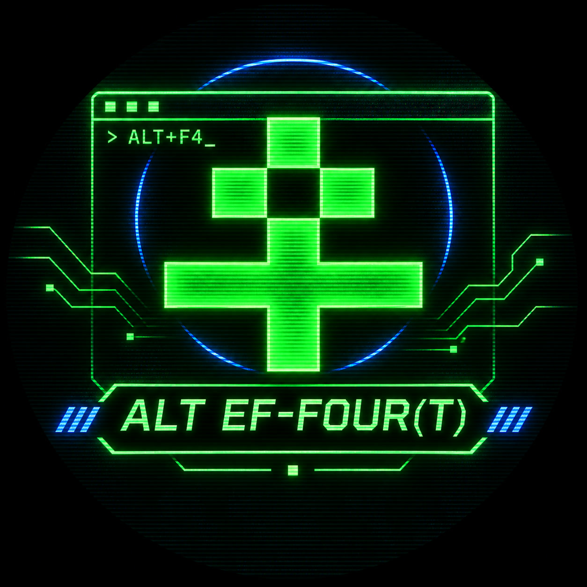

<p align="center">
  
</p>
  
<div align="center">

# ALT EF-FOUR(T)

### [ ALT ] + [ F4 ]

**HACK THE PLANET!**

</div>

```text
C:\> INITIALIZING PROFILE...

> ALIAS       : ALT EF-FOUR(T)
> STATUS      : ONLINE
> EDUCATION   : B.S. COMPUTER SCIENCE
> GPA         : 4.0
> INTERESTS   : SOFTWARE DEVELOPMENT
                CYBERSECURITY
                DATA ANALYSIS

> ACCESS GRANTED_
```

## About Me

Computer Science graduate with a passion for
software development, cybersecurity, and technology.

My interest in programming began with the
1995 movie Hackers. What started as a fascination
with computers became a lifelong interest and
eventually a degree in Computer Science.

I enjoy exploring how systems work, solving
problems, and building reliable software.

## Technical Skills

- Java and object-oriented programming
- Python fundamentals
- SQL and SQLite databases
- Data structures and algorithms
- Software testing with JUnit
- Git and GitHub
- Cybersecurity fundamentals

## Featured Project

### CS 499 — Computer Science Capstone

My capstone ePortfolio demonstrates improvements
in software design, algorithms, data structures,
and database management.

[ACCESS CAPSTONE PORTFOLIO](https://apg83.github.io/)

## Philosophy

> Curiosity drives discovery.
> Knowledge gives us the tools to create.

---

<div align="center">

**ALT EF-FOUR(T)**

`SYSTEM ONLINE // HACK THE PLANET!`

</div>
